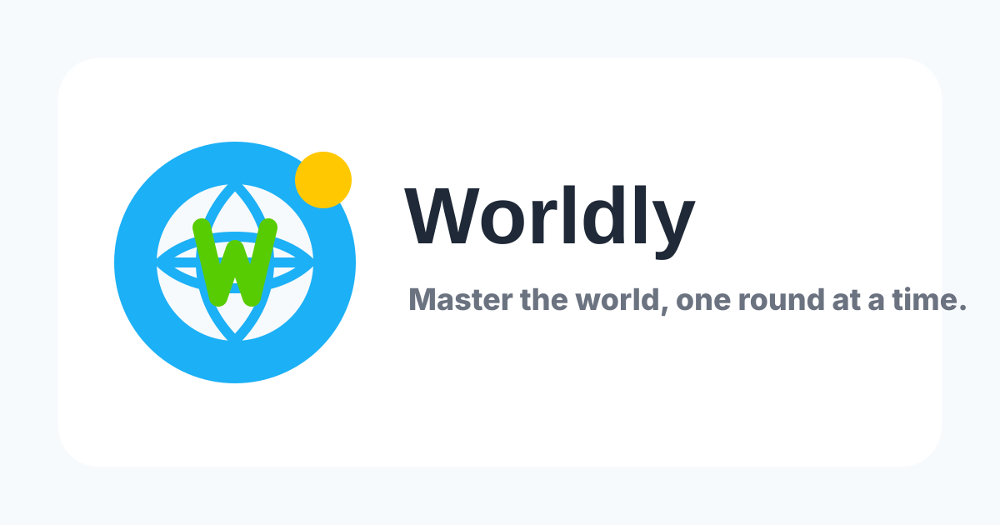

# Flaggo

Flaggo — master world geography, one round at a time.



## Features

- Flag, capital, trivia, map, arcade, daily challenge, and review practice modes.
- Spaced repetition progress saved locally and synced with Supabase when signed in.
- Theme palettes with a light default and persistent user preference.
- PWA install support with offline app shell and cached flag assets.
- Free-MVP launch mode: Stripe checkout and AdSense code remain in the repo but are hidden by default behind feature flags.

## Stack

- Vite, React, TypeScript, Tailwind CSS
- Supabase Auth, Postgres, RLS, and realtime-friendly match tables
- Netlify static hosting and functions
- Vitest and Testing Library
- Optional Plausible analytics and Sentry diagnostics

## Local Development

```bash
npm install
npm run dev
```

Create a local `.env` with the required client values:

```bash
VITE_SUPABASE_URL=...
VITE_SUPABASE_ANON_KEY=...
VITE_SITE_URL=http://localhost:5173
VITE_ADS_ENABLED=false
VITE_MONETIZATION_ENABLED=false
```

Run the production build and tests:

```bash
npm run build
npm test
```

## Environment Variables

| Variable | Required | Default | Notes |
| --- | --- | --- | --- |
| `VITE_SUPABASE_URL` | Yes |  | Supabase project URL. |
| `VITE_SUPABASE_ANON_KEY` | Yes |  | Public anonymous key. |
| `VITE_SITE_URL` | Yes | current origin | Used for auth callbacks and share URLs. |
| `VITE_ADS_ENABLED` | No | `false` | When false, ad slots and consent UI render nothing. |
| `VITE_MONETIZATION_ENABLED` | No | `false` | Gates premium/checkout UI for post-MVP monetization. |
| `VITE_PLAUSIBLE_DOMAIN` | No |  | Enables Plausible when configured. |
| `VITE_SENTRY_DSN` | No |  | Enables Sentry when configured. |
| `VITE_ADSENSE_CLIENT_ID` | No |  | Only used when ads are explicitly enabled. |
| `VITE_STRIPE_PUBLISHABLE_KEY` | No |  | Reserved for future checkout UI. |

Server-only Netlify function values are needed for username-only signup, account deletion, and monetization:

| Variable | Used by | Notes |
| --- | --- | --- |
| `SUPABASE_URL` | Netlify functions | Supabase project URL. |
| `SUPABASE_SERVICE_ROLE_KEY` | Netlify functions | Required for username-only signup, account deletion, and Stripe webhook writes. |
| `STRIPE_SECRET_KEY` | Stripe functions | Deferred for the free MVP. |
| `STRIPE_PRICE_ID` | Checkout function | Deferred for the free MVP. |
| `STRIPE_WEBHOOK_SECRET` | Webhook function | Deferred for the free MVP. |

## Supabase

Apply the migrations in order to a fresh project:

1. `supabase/migrations/202606180001_flaggo_v1.sql`
2. `supabase/migrations/202606180002_leaderboards.sql`
3. `supabase/migrations/202606180003_matches.sql`
4. `supabase/migrations/202606180004_handle_no_email.sql`

The migrations enable Row Level Security for profiles, progress, entitlements, purchases, leaderboards, matches, match results, and friend links. Configure Supabase Auth for email/password accounts, matching the provider used by `src/auth/SignInModal.tsx`.

## Deploy

Netlify settings:

- Build command: `npm run build`
- Publish directory: `dist`
- Functions directory: `netlify/functions`

Set `VITE_SUPABASE_URL`, `VITE_SUPABASE_ANON_KEY`, `VITE_SITE_URL`, `VITE_ADS_ENABLED=false`, and `VITE_MONETIZATION_ENABLED=false` for the free launch. Optional analytics and diagnostics env vars can be added without changing app behavior.

The production smoke test should cover sign-in, progress sync, one full round in the primary modes, leaderboards, multiplayer, theme persistence, account deletion, PWA installability, deep links, and the OG preview.
